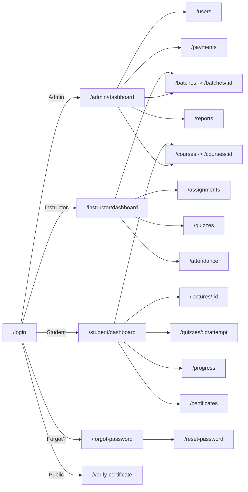

# UI/UX Design & Wireframes Specification

**Document Version:** 1.1  
**Author:** Software Architecture Team  
**Last Updated:** 2026-11-25  

---

## 1. Design System & Tokens

### Color Palette
- **Primary Brand**: Indigo 600 (`#4F46E5`) / Indigo 700 (`#4338CA`)
- **Surface / Background**: Slate 50 (`#F8FAFC`) for main canvas, White (`#FFFFFF`) for cards, Slate 900 (`#0F172A`) for sidebar & auth backdrop
- **Typography**: Inter / System Sans-Serif (`#1E293B` primary text, `#64748B` secondary text)
- **Semantic Badges**:
  - Success / Present / Paid: Emerald (`#10B981` / `bg-emerald-50 text-emerald-700`)
  - Warning / Partial / Pending: Amber (`#F59E0B` / `bg-amber-50 text-amber-700`)
  - Danger / Absent / Overdue: Rose (`#F43F5E` / `bg-rose-50 text-rose-700`)
  - Info / Active: Blue (`#3B82F6` / `bg-blue-50 text-blue-700`)

### Reusable Component Library (`frontend/src/components/`)
- `Sidebar.jsx` — Role-adaptive left navigation rail (`256px` fixed desktop, collapsible mobile)
- `Header.jsx` — Top bar (`64px`) with role pill, notification bell dropdown, and logout action
- `StatCard.jsx` — KPI summary card with icon, metric value, and trend subtitle
- `DataTable.jsx` — Searchable, sortable, paginated tabular display with empty state
- `Modal.jsx` — Accessible dialog overlay for create/edit/confirm workflows
- `Badge.jsx` — Semantic status pill
- `LoadingSpinner.jsx` — Centered loading indicator

---

## 2. Navigation Flow



---

## 3. Screen Wireframes (Section 8 SRS)

### 3.1 Login & Password Recovery (`/login`, `/forgot-password`, `/reset-password`)
```text
+-------------------------------------------------------------------+
|                        [Dark Slate Backdrop]                      |
|           +-------------------------------------------+           |
|           |  [Indigo Gradient Banner + LMS Icon]      |           |
|           |  Welcome to LMS / Enterprise Academic     |           |
|           +-------------------------------------------+           |
|           |  Fast Demo Login: [Admin] [Inst] [Student]|           |
|           |  Email Address: [_______________________] |           |
|           |  Password:      [________] Forgot?        |           |
|           |  [        Sign In to Portal  ->         ] |           |
|           |  ---------------------------------------  |           |
|           |      Public Certificate Verification      |           |
|           +-------------------------------------------+           |
+-------------------------------------------------------------------+
```

### 3.2 Admin Dashboard (`/admin/dashboard`)
```text
+------------+------------------------------------------------------+
|  SIDEBAR   | HEADER: LMS Portal       [ADMIN] [Bell] [Logout]     |
|            +------------------------------------------------------+
| Dashboard  | [Total Students] [Instructors] [Courses] [Batches]   |
| Users      | [Active Batches] [Enrollments] [Revenue] [Pending]   |
| Courses    +---------------------------+--------------------------+
| Batches    | Enrollment Trends (Line)  | Payment Status (Pie)     |
| Assignments|                           |                          |
| Quizzes    +---------------------------+--------------------------+
| Attendance | Course Distribution (Bar) | Recent Activity & Quick  |
| Certs      |                           | Actions                  |
| Payments   +---------------------------+--------------------------+
| Reports    | Recent Enrollments Table                             |
+------------+------------------------------------------------------+
```

### 3.3 Instructor & Student Dashboards (`/instructor/dashboard`, `/student/dashboard`)
- **Instructor**: Assigned Courses, Assigned Batches, Total Students, Upcoming Lectures, Pending Evaluations list, Recent Submissions table, Batch Attendance Summary chart.
- **Student**: Enrolled Courses, Assigned Batches, Completed vs Pending Lectures, Pending Assignments, Upcoming Quizzes, Attendance %, Overall Course Progress bar, Recent Results, Notifications feed.

### 3.4 Course Listing & Course Detail (`/courses`, `/courses/:id`)
- **Listing**: Search bar, category/status filters, responsive card/table grid with fee, duration, and `+ Create Course` modal (Admin).
- **Detail**: Course header, instructor info, fee & duration metadata, collapsible **Modules -> Lectures** accordion tree, and enrolled batches list.

### 3.5 Batch Management & Roster (`/batches`, `/batches/:id`)
- **Listing**: Batch code, linked course, assigned instructor, start/end dates, schedule, capacity (`enrolled/max`), status badge.
- **Detail**: Student roster table with `Enroll Student` / `Remove` actions, batch lectures, and attendance summary.

### 3.6 Lecture Room (`/lectures/:id`)
```text
+----------------------------------+--------------------------------+
|  [Embedded Video Player / Link]  |  Module & Lecture Checklist    |
|                                  |  [x] 1.1 Intro to Python       |
|  Lecture Title & Description     |  [ ] 1.2 Data Structures       |
|  [Mark Lecture Completed]        |                                |
+----------------------------------+--------------------------------+
|  Study Materials:  [Slides.pdf v]  [Cheatsheet.pdf v]             |
+-------------------------------------------------------------------+
```

### 3.7 Assignments & Submissions (`/assignments`)
- Tabs/Filters by Batch & Status (`Pending`, `Submitted`, `Evaluated`, `Late`).
- Student view: Download reference file, upload submission modal (`PDF/ZIP/PY/DOCX`).
- Instructor/Admin view: View submissions table, open **Evaluate** modal to assign marks (`<= max_marks`) and qualitative feedback.

### 3.8 Timed MCQ Quiz & Attempt (`/quizzes`, `/quizzes/:id/attempt`)
- **Quiz List**: Available quizzes, duration, total marks, passing marks, start/view results actions.
- **Quiz Attempt**: Top sticky countdown timer (`MM:SS`), question navigator pills, single-choice radio options (`is_correct` never sent to client), `Submit Quiz` confirmation, and instant server-calculated score summary.

### 3.9 Attendance, Progress, Payments, Certificates & Reports
- **Attendance (`/attendance`)**: Batch + Date selector, student roster with `Present / Absent / Late / Excused` toggles, monthly summary & percentage.
- **Progress (`/progress`)**: Weighted formula breakdown (`40% Lectures + 30% Assignments + 30% Quizzes`) with progress bars.
- **Payments (`/payments`)**: Fee ledger, status badges (`PAID`, `PARTIAL`, `PENDING`), record payment modal (Admin), and `Download PDF Receipt`.
- **Certificates (`/certificates`, `/verify-certificate`)**: Eligibility check, `Generate Certificate` button, `Download PDF`, and public verification search by `certificate_code`.
- **Reports (`/reports`)**: Date/Batch filters, Recharts visualizations, and `Export CSV / Excel / PDF` buttons.
