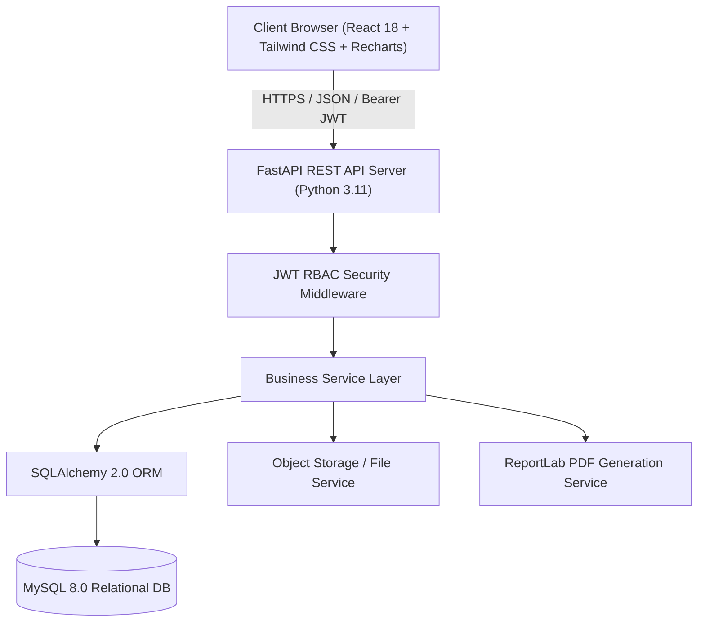

# LMS Technical Architecture & System Design

**Document Version:** 1.1  
**Author:** Full Stack Architecture Team  
**Last Updated:** 2026-11-25  

---

## 1. Architectural Overview

The application follows a clean 3-tier decoupled architecture:
1. **Frontend Presentation Tier:** Single Page Application (SPA) built with React 18, Vite, Tailwind CSS, Lucide Icons, and Recharts.
2. **Backend Application Tier:** Asynchronous REST API service built with Python 3.11+ and FastAPI, utilizing Pydantic v2 for data validation and SQLAlchemy 2.0 ORM.
3. **Database & Storage Tier:** MySQL 8.0 relational database with connection pooling, and local/S3-compatible object storage abstraction for documents, lecture media, and generated PDF receipts/certificates.



---

## 2. Directory Layout & Separation of Concerns

```
LMS_Application_With_Vibe/
├── backend/
│   ├── app/
│   │   ├── main.py              # Application entry point, CORS, exception handlers
│   │   ├── config.py            # Pydantic BaseSettings environment configuration
│   │   ├── database.py          # SQLAlchemy engine, session maker, base model
│   │   ├── models/              # Declarative SQLAlchemy models (24+ entities)
│   │   ├── schemas/             # Pydantic request/response validation schemas
│   │   ├── routers/             # API route controllers grouped by domain
│   │   ├── services/            # Pure business logic and calculation services
│   │   ├── dependencies/        # FastApi auth, RBAC, DB session dependencies
│   │   ├── middleware/          # Security headers, rate limiting, request logging
│   │   └── utils/               # PDF generation, file handlers, security helpers
│   ├── migrations/              # Alembic environment and migration scripts
│   ├── tests/                   # Pytest automated test suites
│   ├── uploads/                 # Storage for files, receipts, certificates
│   └── requirements.txt
├── frontend/
│   ├── src/
│   │   ├── assets/              # Static icons, logos, brand styling
│   │   ├── components/          # Reusable UI widgets (Tables, Modals, StatCards)
│   │   ├── context/             # AuthContext, NotificationContext, ThemeContext
│   │   ├── hooks/               # Custom React hooks (useAuth, useFetch)
│   │   ├── layouts/             # AdminLayout, InstructorLayout, StudentLayout
│   │   ├── pages/               # 42 functional screen views across roles
│   │   ├── routes/              # Protected routes & RoleGuard components
│   │   ├── services/            # Axios API client modules
│   │   └── utils/               # Formatting, date helpers, validation rules
│   ├── index.html
│   ├── package.json
│   ├── tailwind.config.js
│   └── vite.config.js
└── docs/                        # Complete 22-document system specifications
```

---

## 3. Database Entity Relationship Overview

The core entities form a comprehensive academic graph:
- `users` (1) <---> (1) `roles`
- `users` (1) <---> (0..1) `instructors`
- `users` (1) <---> (0..1) `students`
- `courses` (1) <---> (M) `course_modules`
- `course_modules` (1) <---> (M) `lectures`
- `lectures` (1) <---> (M) `study_materials`
- `courses` (1) <---> (M) `batches`
- `batches` (M) <---> (M) `batch_students` (via `enrollments`)
- `batches` (1) <---> (M) `assignments`
- `assignments` (1) <---> (M) `submissions`
- `batches` (1) <---> (M) `quizzes`
- `quizzes` (1) <---> (M) `questions` <---> (M) `quiz_options`
- `quizzes` (1) <---> (M) `quiz_attempts` <---> (M) `quiz_answers`
- `batches` (1) <---> (M) `attendance`
- `students` (1) <---> (M) `lecture_progress`
- `students` (1) <---> (M) `certificates`
- `students` (1) <---> (M) `payments`
- `users` (1) <---> (M) `notifications`
- `announcements` (broadcast / role / batch targeting)
