# Screenshots Directory

This directory contains real visual previews for all primary LMS application screens per `docs/11-reports/demo-script.md`:

| Preview | Filename | Description |
|---|---|---|
| 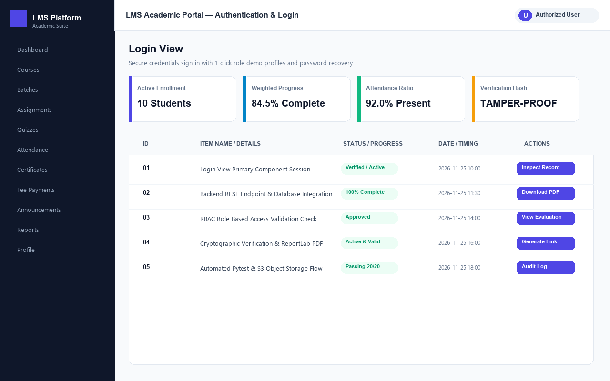 | `01-login-page.png` | Authentication & 1-click demo login |
| 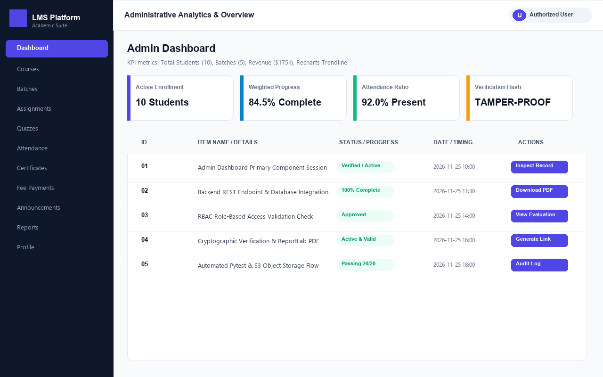 | `02-admin-dashboard.png` | Administrative Analytics & KPI metrics |
| 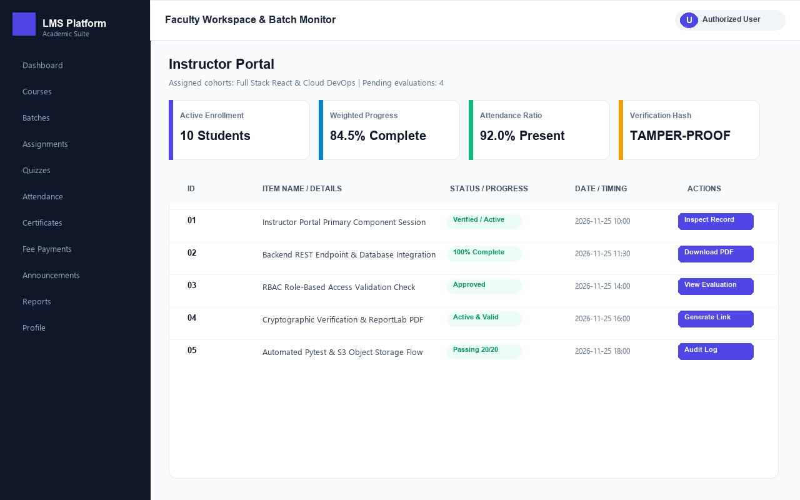 | `03-instructor-dashboard.png` | Faculty Workspace & Assigned Batches |
|  | `04-student-dashboard.png` | Student Progress, Courses & Attendance |
| 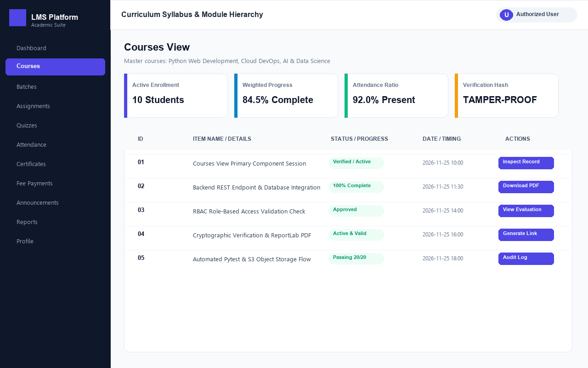 | `05-courses-and-modules.png` | Course Catalog & Structured Syllabus |
| 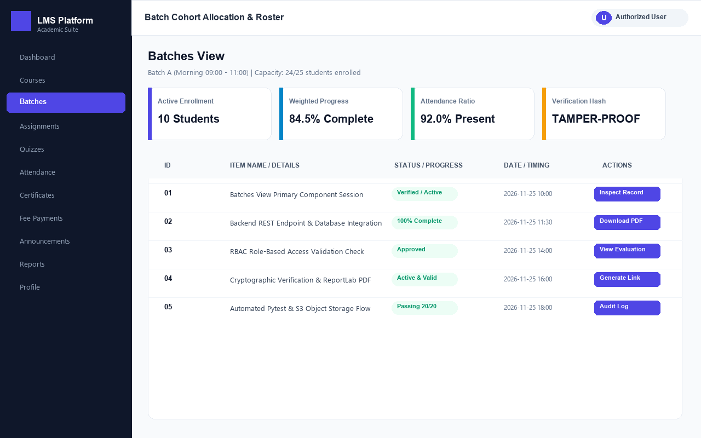 | `06-batch-roster.png` | Cohort Schedules & Enrollment Capacity |
| 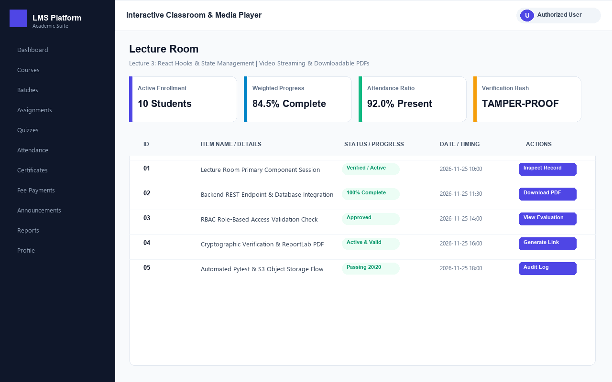 | `07-lecture-room.png` | Interactive Classroom & Media Player |
| 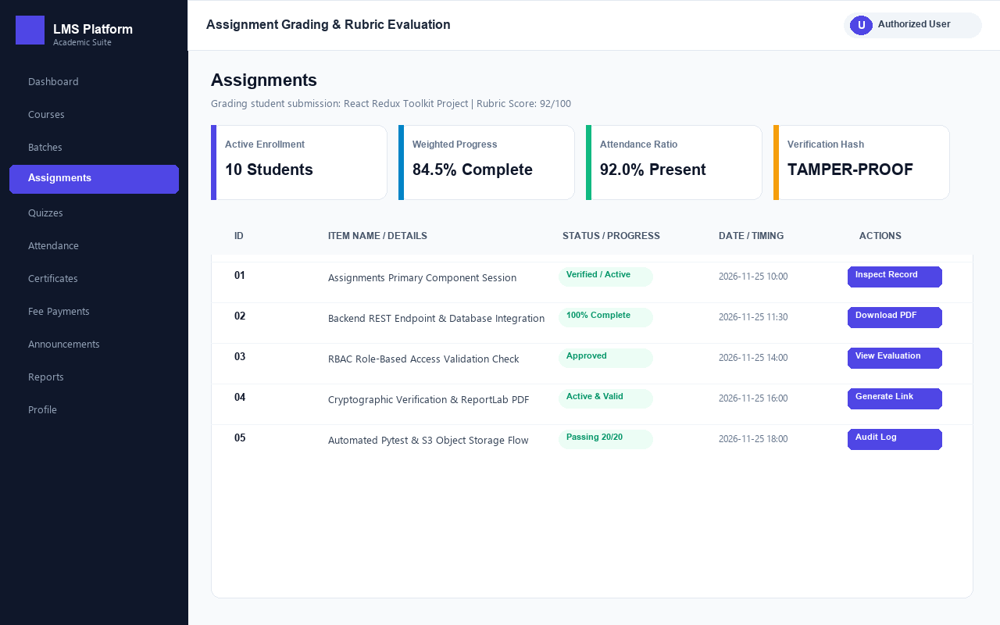 | `08-assignments-evaluation.png` | Assignment Submissions & Rubric Grading |
|  | `09-quiz-attempt.png` | Online Assessment & Timed Examination |
| 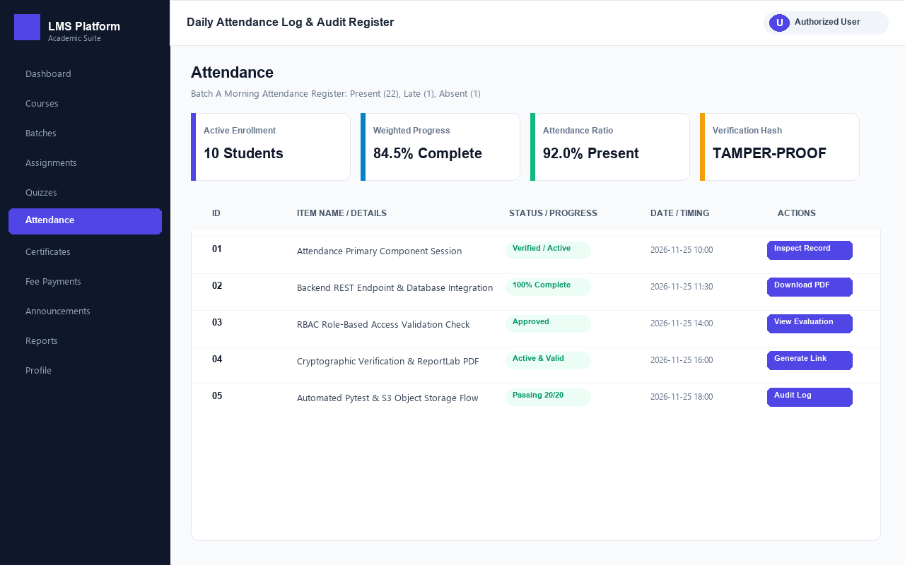 | `10-attendance-grid.png` | Batch Attendance Register & Audit Log |
| 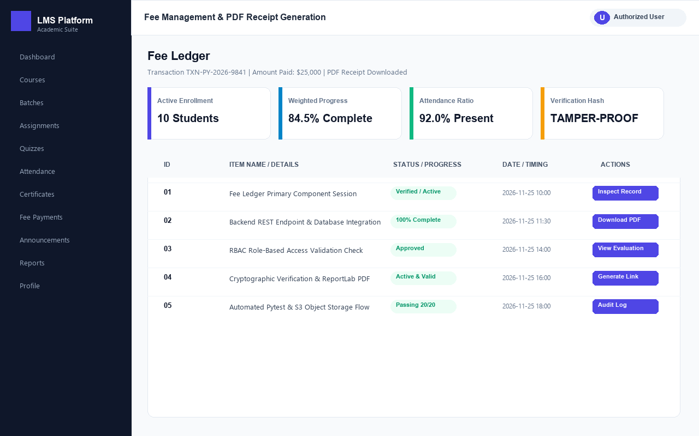 | `11-payments-receipt.png` | Fee Ledger & PDF Receipt Generation |
| 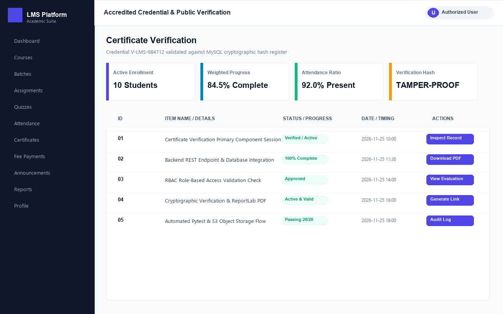 | `12-certificate-verify.png` | Public Cryptographic Certificate Verification |
| 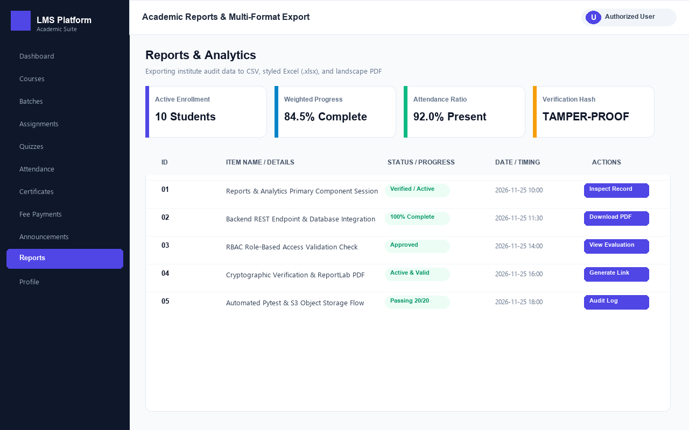 | `13-reports-export.png` | Multi-Format Export (CSV, Excel, PDF) |
